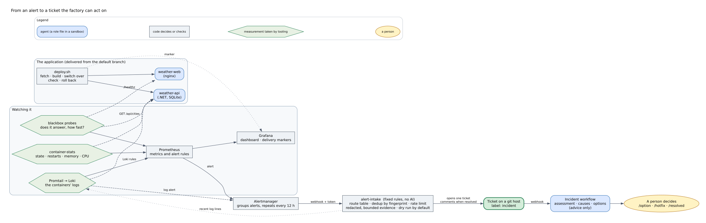

# dev-foundry demo: a production with monitoring that opens tickets

A small "production" (a small shop in `app/`: a Python API with SQLite and a static page behind nginx) with monitoring around it that **opens a ticket when something breaks**. Everything runs locally in Docker. It shows the whole loop of [dev-foundry](https://github.com/OWNER/dev-foundry): a delivery, a failure, an alert, a ticket on a git host and, if a factory serves that repository, its incident workflow. **You do not need the factory to run it**: without one, the tickets are just tickets (or only log lines, in a dry run).



| Part | What it is | Address (localhost only) |
| --- | --- | --- |
| shop-web, shop-api | the application, built from `app/` | http://localhost:8081, API http://localhost:5080/api/products |
| Prometheus | metrics and alert rules; probes the API and the web page from outside, like a user | http://localhost:9090 |
| container-stats | state, health, restarts, memory and CPU of every container, read from the Docker API (`exporter/container_stats.py`) | (inside the stack) |
| Loki + Promtail | the containers' logs, searchable, with alert rules on log lines | (inside the stack) |
| Alertmanager | groups alerts and sends them on | http://localhost:9093 |
| Grafana | two dashboards: **Overview** (the home page) and **Shop service** (details) | http://localhost:3001 (user `admin`, password in `.env`) |
| alert-intake | turns an alert into a ticket on a git host: [its README](https://github.com/OWNER/dev-foundry-alert-intake) | (inside the stack) |

## Start it

You need Docker with Compose, `curl` and `python3`, and a checkout of the alert intake next to this folder:

```sh
git clone https://github.com/OWNER/dev-foundry-alert-intake ../dev-foundry-alert-intake   # (or set ALERT_INTAKE_SOURCE in .env)
./setup.sh                    # first start: prepares everything; alerts are only LOGGED (a dry run)
```

`setup.sh` checks Docker, writes `.env` and `secrets/` (random passwords and tokens, kept on re-runs, never committed), builds and starts the monitoring, delivers the application with `deploy.sh`, and waits until everything answers. Run it again whenever you like: it keeps what it generated.

### Real tickets

A dry run needs no git host. To open real tickets, put these in `.env` (see `.env.example`) and run `./setup.sh --create-tickets`:

| Setting | Meaning |
| --- | --- |
| `DEMO_GIT_TYPE` | `forgejo` (the default) or `github` |
| `DEMO_GIT_URL` | where the intake reaches it: `https://github.com`, or your Forgejo (one on this machine: `http://host.docker.internal:3000`) |
| `DEMO_REPO` | `owner/name` of the repository that receives the tickets (use a scratch repository) |
| `DEMO_GIT_TOKEN` | a token that may create issues there: on GitHub a fine-grained token with **Issues** read and write; on Forgejo `write:issue` (and `write:repository` to create the `incident` label) |

If a dev-foundry factory serves that repository, a ticket labelled `incident` starts its incident workflow, which **spends model tokens**. That is why a dry run is the default. To go back to one, set `ALERT_INTAKE_DRY_RUN=true` in `.env` and run `./setup.sh`.

## See what is happening

| Where | What you see |
| --- | --- |
| **Grafana → Overview** (the home page) | at the top: is the API up, is the web page up, how many alerts fire, whether a monitoring part is down, whether alerts open real tickets or are only logged (dry run), how many alerts were handled in 24 hours. Below: the active alerts, a timeline of when each alert was pending or firing, what the alert intake did with them (a chart and its decision log), the deliveries, every container (running, for how long, restarts, memory, CPU) and the logs |
| **Grafana → Shop service** | the details of the application: response time, memory, CPU, error lines per minute, logs. Orange markers are deliveries |
| `./status.sh` | the same in one screen of text: containers, probes, alerts, what the intake did and its last decisions, the deliveries, and the tickets opened from alerts |
| Prometheus → Alerts | every rule and its state: inactive, pending (waiting out its `for` time) or firing: http://localhost:9090/alerts |
| Alertmanager | the alerts that were sent on, and silences: http://localhost:9093 |
| `docker compose logs -f alert-intake` | every decision of the intake as it happens |
| **Your git host** | the tickets themselves (label `incident`, title `[alert] ...`) and, with a factory behind it, its incident workflow on them |

The monitoring watches itself: a part that stops answering, an intake that cannot reach the git host, one that holds tickets back, and one that refuses notifications each have an alert (`service: monitoring`). Those alerts open **no** tickets; you see them in Alertmanager and on the Overview.

## Deliver code to "production"

```sh
./deploy.sh              # build images tagged with this repository's commit, switch over, check, roll back by itself if it does not answer
./deploy.sh --force      # deliver it even when it is already running
./deploy.sh --rollback   # back to the previous delivered version
```

Change something in `app/`, commit it, run `./deploy.sh`. Uncommitted changes are delivered too, as `<commit>-dirty`. Each delivery is a line in `deployments.log` and an orange marker on the Grafana dashboard, so a change in the graphs can be tied to a delivery. This is a small stand-in for a delivery pipeline.

## Break it on purpose

```sh
./simulate.sh api-down    # stop the API: ShopApiDown fires after about a minute
./simulate.sh errors      # write error lines to the API log: ShopApiErrorLogs fires
./status.sh              # one screen: containers, alerts, what the intake did, deliveries, tickets
./simulate.sh restore     # start everything again; the alerts resolve and the ticket gets a comment
docker compose logs -f alert-intake
```

The path of an alert: Prometheus (or Loki) evaluates a rule, the alert stays **pending** for its `for` time (1 minute for the "down" alerts), Alertmanager waits 30 seconds to group alerts, then posts to the intake. In a dry run the log says `Dry run: would open a ticket in your repository titled [alert] ShopApiDown: ...`; otherwise a ticket appears.

## The alerts

| Alert | Fires when | Source |
| --- | --- | --- |
| ShopApiDown | `GET /api/products` fails for 1 minute | Prometheus, blackbox probe |
| ShopWebDown | the web page's health check fails for 1 minute | Prometheus, blackbox probe |
| ShopApiSlow | the API takes more than 1 second for 3 minutes | Prometheus, blackbox probe |
| ShopApiMemoryHigh | the API container uses more than 400 MB for 5 minutes | Prometheus, container-stats |
| ShopApiRestarting | Docker restarted the API container more than twice in 15 minutes | Prometheus, container-stats |
| ShopApiUnhealthy | Docker's health check of the API container fails for 2 minutes | Prometheus, container-stats |
| ShopApiErrorLogs | more than 5 error lines in the API log within 5 minutes | Loki rule |

The rules are in `prometheus/rules/shop.yml` and `loki/rules/fake/shop.yml`; the alerts about the monitoring itself are in `prometheus/rules/monitoring.yml`. Which alert goes to which repository is the route table `setup.sh` writes to `generated/mapping.json` (from `DEMO_REPO`).

## Stop it

```sh
./down.sh           # stop; data is kept
./down.sh --purge   # also remove the data
```

## What to know

- **Local only.** Every port is bound to 127.0.0.1. Promtail and container-stats read the Docker socket, which is root on the host, so this stack is for your own machine, not a server.
- **It is not the factory's sandbox.** The application runs here with normal networking. The factory's agents never get access to it; they see only what a ticket says.
- **The frontend's API address is built in** (`http://localhost:5080`), so the application is reachable from your browser on this machine only.
- **Configuration** (ports, the git host and repository) is in `.env`; `.env.example` lists the keys. The alert intake's settings are in [its README](https://github.com/OWNER/dev-foundry-alert-intake).

## If something does not work

| Symptom | Likely cause and fix |
| --- | --- |
| `setup.sh` stops with "error getting credentials" while pulling images | Docker's credential helper failed under many parallel pulls (seen under WSL2). Pull the images one at a time (`docker pull prom/alertmanager:v0.28.1`, and so on for the images in `compose.yaml`), then run `./setup.sh` again |
| `docker compose` cannot find the alert intake's source | clone it next to this folder (see "Start it") or set `ALERT_INTAKE_SOURCE` in `.env` |
| an alert fires but no ticket appears | the intake is in dry run (the Overview says so; `./status.sh` too), or the token or repository is wrong (`docker compose logs alert-intake`), or the alert matches no route in `intake-routes/mapping.json`, or the hourly limit is reached: `docker compose logs alert-intake` says which |
| the intake log shows "unauthorized" or Prometheus shows `AlertIntakeRefusingNotifications` | Alertmanager and the intake do not share the token: run `./setup.sh` again (it rewrites `secrets/intake-token` from `.env`) and `docker compose up -d alertmanager alert-intake` |
| a panel on a dashboard is empty | give it a minute after a restart; then check Prometheus → Status → Targets: every target must be up |
| `deploy.sh` says a version does not answer | it rolled back by itself; look at `docker compose logs shop-api` for the failed version |

## License

[MIT](LICENSE).
